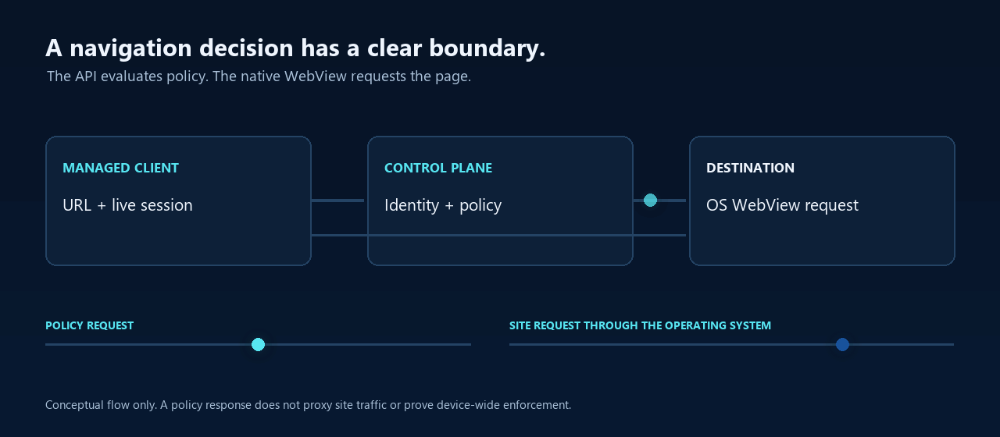
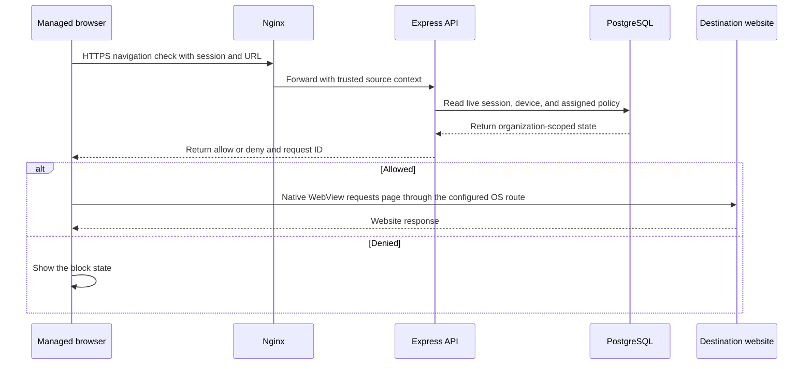
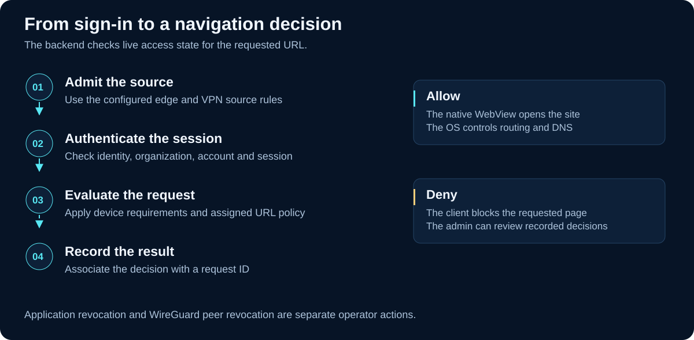
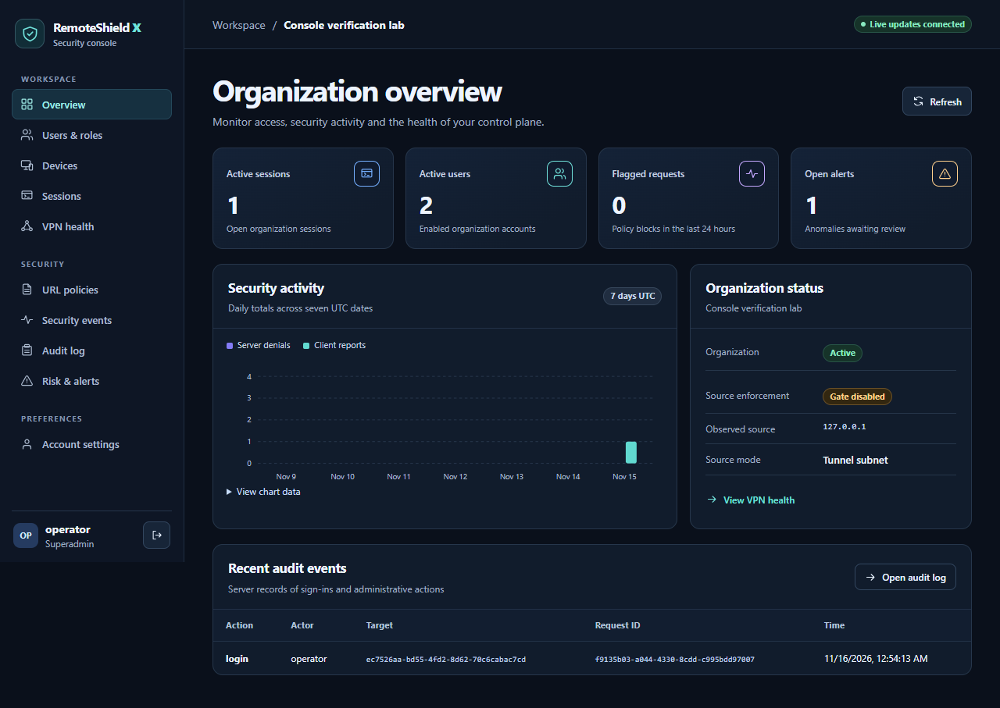
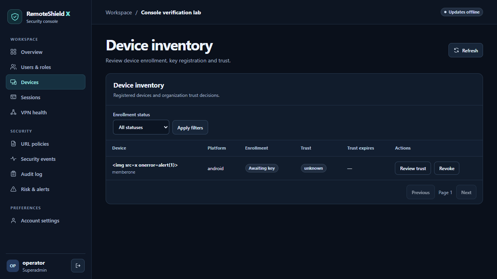
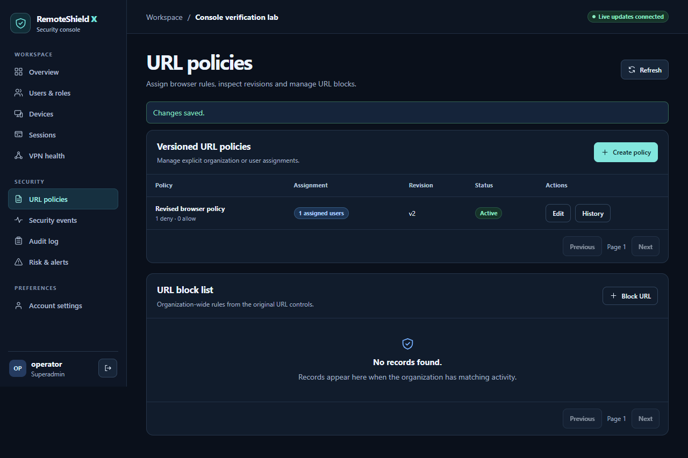

<picture>
  <source media="(prefers-reduced-motion: reduce)" srcset="assets/readme/remoteshield-hero.webp">
  
</picture>

# RemoteShield X

**Managed browsing with explicit access decisions for remote teams.**

[](docs/ROADMAP.md) [](docs/ARCHITECTURE.md) [](docs/API_REFERENCE.md)

RemoteShield X gives organizations a managed desktop and Android browser, an administration console, and an API that decides which users, devices, and sessions can open a URL. Administrators can assign policies, review access decisions, and revoke access from the same console. Organizations that need an enforced network path can deploy the separate WireGuard gateway and configure routing, DNS, and firewall policy on managed devices.

[Static, reduced-motion edition](docs/README_STATIC.md) · [Getting started](docs/GETTING_STARTED.md) · [Technical report](output/pdf/RemoteShield-X-Technical-Report.pdf) · [PowerPoint briefing](docs/deliverables/RemoteShield-X-Company-Briefing.pptx)

[Architecture](#architecture) · [Security workflow](#security-workflow) · [Screenshots](#real-application-captures) · [Local setup](#platform-and-setup) · [Downloads](#published-application-downloads) · [Verification](#verification-and-release-gates)

## What RemoteShield X is

The project is built for teams that want managed access to browser based services such as internal portals and partner dashboards. A deployment consists of the browser clients, a control plane, and an administration console. Production networking adds a separately operated gateway and managed device configuration.

| Role | Typical workflow |
| --- | --- |
| Team member | Sign in to the organization, complete enrollment where required, and open an approved site in the managed browser. |
| Organization administrator | Review and approve devices, assign URL policies, inspect access decisions, and terminate an account’s sessions when needed. |
| Infrastructure operator | Configure the TLS edge, apply database migrations, provision WireGuard peers and managed routes, and verify backup recovery. |
| Security reviewer | Correlate a request ID with an audit record, review policy changes, and check which controls were exercised in CI or a lab. |

For example, a team can assign an allow policy for a partner portal to a directory group and apply an organization-wide deny rule for a second destination. An allowed navigation opens in the native WebView. A denied navigation stops at the browser, and authorized administrators can review the recorded outcome. If a laptop is lost, the administrator can revoke the application device or session and the operator can separately revoke its WireGuard peer.

## Published application downloads

The latest published stable GitHub release currently visible is **`v2.4.0`**, published **2026-04-18**. **Do not install its Android APKs:** inspection of the released ARM64 APK found application ID `com.example.android`, version `1.0.0`, and a generic Flutter launcher, which do not match this project’s Android package (`com.remoteshieldx.browser`) or its native `MainActivity`. This mismatch can explain an app opening as a blank screen and means the published APK is not a verified build of the current source. A corrected release has not yet been built, signed, or published. The links below are a historical inventory only. The release tag is unsigned and the desktop installer filenames identify version `2.2.4` while the tag is `v2.4.0`. SHA-256 values identify downloaded bytes; they do not verify publisher identity or safety.

| Platform | Release asset | SHA-256 |
| --- | --- | --- |
| Android ARM64 | [app-arm64-v8a-release.apk](https://github.com/manikantbindass/RdPBrowser/releases/download/v2.4.0/app-arm64-v8a-release.apk) | `50a791e82f3a2aa845f2b37fe9158dbab17c879147d6306a7650df3c30f7cf18` |
| Android ARMv7 | [app-armeabi-v7a-release.apk](https://github.com/manikantbindass/RdPBrowser/releases/download/v2.4.0/app-armeabi-v7a-release.apk) | `631ce08c1d3cd037848217ab754dd1d4b2ba7270e810193a55e71cd2f4e2eb1b` |
| Android x86-64 | [app-x86_64-release.apk](https://github.com/manikantbindass/RdPBrowser/releases/download/v2.4.0/app-x86_64-release.apk) | `c87aa8db0a8fc12617c67240b7cb1d75aa04c2dbdc8b2d9971ebfc72bb91d33d` |
| Linux x86-64 Arch archive | [RemoteShield-Linux-Arch-x86_64.tar.gz](https://github.com/manikantbindass/RdPBrowser/releases/download/v2.4.0/RemoteShield-Linux-Arch-x86_64.tar.gz) | `9a2f9c5216e28d077f53251114252a95d98cecd2e279f34cc45dcbbf64cd7e57` |
| Linux x86-64 AppImage | [RemoteShield.X_2.2.4_amd64.AppImage](https://github.com/manikantbindass/RdPBrowser/releases/download/v2.4.0/RemoteShield.X_2.2.4_amd64.AppImage) | `6c6e29585c87f225f5eb71c17b9b599aaed322329d83b83af0ce19d58b020604` |
| Debian/Ubuntu x86-64 | [RemoteShield.X_2.2.4_amd64.deb](https://github.com/manikantbindass/RdPBrowser/releases/download/v2.4.0/RemoteShield.X_2.2.4_amd64.deb) | `ef81523e5f7719dcf6dec362f6d53bfb78a4ae91383a177735b16154da1d2b29` |
| macOS universal DMG | [RemoteShield.X_2.2.4_universal.dmg](https://github.com/manikantbindass/RdPBrowser/releases/download/v2.4.0/RemoteShield.X_2.2.4_universal.dmg) | `c414a5e22c01c7b405def7afd8cc43a9fc6d837364d0f2483c930e9308136417` |
| Windows x86-64 installer | [RemoteShield.X_2.2.4_x64-setup.exe](https://github.com/manikantbindass/RdPBrowser/releases/download/v2.4.0/RemoteShield.X_2.2.4_x64-setup.exe) | `e4fef0d8518f05f406e0dea03c6a05688b2bf5a2656ce07fd7e61eb7af976489` |
| Windows x86-64 MSI | [RemoteShield.X_2.2.4_x64_en-US.msi](https://github.com/manikantbindass/RdPBrowser/releases/download/v2.4.0/RemoteShield.X_2.2.4_x64_en-US.msi) | `3b340fc9a530e0f39d782bdeb12b92d1d0212a3d3e79040c896334bd24f34c0b` |

[Open the GitHub release](https://github.com/manikantbindass/RdPBrowser/releases/tag/v2.4.0) · [Machine-readable release inventory and audit notes](docs/audit/phase16/release-assets-v2.4.0.json)

There is no published iOS package in this release. The `v2.5.0-preview.4` source preview is not a GitHub Release and has no published release assets. Do not infer a supported platform or current-source compatibility from an asset filename. Inspect and verify downloaded binaries under your organization’s software intake process before use.

## Motion and visual documentation

The seven-second hero highlights enrollment, policy evaluation, and opening an approved site. The following loops illustrate how control requests and page traffic move through the system. They use original artwork and separate static WebP versions. Readers can switch to the [static edition](docs/README_STATIC.md) when their Markdown viewer cannot apply the reduced motion setting.

### Access decision and browser traffic boundary

<picture>
  <source media="(prefers-reduced-motion: reduce)" srcset="assets/readme/remoteshield-access-flow.webp">
  
</picture>

### Optional VPN enforcement boundary

<picture>
  <source media="(prefers-reduced-motion: reduce)" srcset="assets/readme/remoteshield-network-boundary.webp">
  
</picture>

Rebuild the illustrations and loops with `python scripts/build_readme_assets.py`. [Animation source, timings, and accessibility notes](assets/readme/README.md)

## Implementation and evidence

| Area | Implemented and verified | Acceptance still open |
| --- | --- | --- |
| Backend | Versioned REST, PostgreSQL migrations and tenant isolation, refresh rotation, revocation, URL policy, audit and events. Hosted run passed 156 unit and 48 database integration tests. | Review remaining static analysis findings and verify the deployment with the intended users and load. |
| Desktop | Tauri 2, Rust, React and TypeScript. Windows, Linux and Intel macOS native checks passed. The preview built Windows and Linux x64 installers and a universal macOS DMG. | Production signatures, notarization, native install and upgrade acceptance, and per-OS network enforcement. |
| Android | Flutter client with secure refresh storage, device key possession and WebView policy checks. Android 16/API 36 emulator boundary tests and four preview APK builds are recorded. | Physical managed-device acceptance, provisioned lockdown, signed distribution and native enterprise SSO handoff. |
| Network | Per-device WireGuard peers, Linux gateway and client firewall, IPv4/IPv6 routing, DNS and tunnel failure tests in isolated namespaces. | Packet verification of the operator’s complete topology and each managed OS profile. |
| Administration | Tenant-scoped users, devices, sessions, policies, incidents, governance and evidence export. Nine admin browser scenarios passed. | Live identity-provider tenants, independent evidence retention and operational staffing. |
| Delivery | Blocking PR matrix, protected signing and publication, SBOMs, checksums and provenance. The artifact-only preview independently verified all 16 entries. | Five firewall configuration findings, 52 backend static analyzer findings and production signing credentials. |

The verification snapshot uses source commit `8d0f7da` and preview `v2.5.0-preview.4`. The ten passing jobs include 35 Compose deployment and recovery assertions. The required quality gate failed on the two remaining scan jobs. The latest published stable release at this snapshot was `v2.4.0`. [Hosted checks](https://github.com/manikantbindass/RdPBrowser/actions/runs/44484220465) · [Preview verification](https://github.com/manikantbindass/RdPBrowser/actions/runs/44484271833/job/135432691439) · [Audit evidence](docs/audit/phase14/security-remediation.json)

## Architecture


### Component responsibilities

| Component | Responsibility | Implementation |
| --- | --- | --- |
| Desktop browser | Renders trusted app controls and opens managed pages in native WebViews. The Rust shell owns native capabilities and download handling. | Tauri 2, Rust, React, TypeScript |
| Android browser | Restores sessions, checks the managed network path, enrolls a device key, and opens approved pages in Android WebView. | Flutter, Dart, Kotlin, Android Keystore |
| Control plane | Authenticates users, evaluates access, publishes session and policy state, and records events. | Nginx, Node.js, Express, REST, Socket.IO |
| Persistence | Stores organizations, users, enrolled devices, sessions, policies and events. Tenant operations use a restricted runtime role and transaction-local organization context. | PostgreSQL, SQL migrations, row-level security |
| Admin console | Uses authorized API operations for tenant administration, policy and incident management, and evidence export. | Same-origin web UI served through Nginx |
| Network path | Controls peer identity, DNS, routes, and forwarding according to the platform profile and the operator’s deployment. | WireGuard, OS policy, Linux nftables and Unbound |

### How a navigation request moves through the system



`/api/v1/proxy/navigate` supplies a policy decision. Site content flows from the destination to the native WebView via the operating system. In a managed WireGuard deployment, control requests can also traverse the tunnel. The gateway and clients still need their own DNS, IPv4, IPv6, and tunnel failure checks.

[Architecture](docs/ARCHITECTURE.md) · [API reference](docs/API_REFERENCE.md) · [Security model](docs/SECURITY_MODEL.md) · [Threat model](docs/THREAT_MODEL.md)

## Security workflow



1. **Admit and authenticate.** The production edge uses its configured VPN source rules. The backend validates identity and session state, and applies role or resource authorization for protected actions. Refresh tokens rotate and can be revoked as a family.
2. **Establish device trust where required.** Enrollment registers a public key. A signed challenge proves possession of the registered private key. Administrative approval, quarantine, and revocation determine whether the enrolled device can continue using protected resources.
3. **Apply organizational policy.** An administrator can assign URL policy to an organization, users, or directory groups. Deny rules win. When multiple nonempty allow groups apply, the destination must match each group. Policy revisions and administrative changes are recorded for review.
4. **Respond to changes.** Administrators can terminate sessions, revoke devices, and review detections in the console. Application revocation and WireGuard peer revocation are separate actions. Check both when containing a lost device.

| Control | How to evaluate it |
| --- | --- |
| Tenant isolation | Exercise cross-tenant denials in the API integration suite and verify the runtime role cannot bypass row-level security. |
| Browser navigation policy | Test representative allowed URLs, denied URLs, redirects, and policy changes on the supported native clients. Callbacks cover selected navigation transitions. |
| Device trust | Verify key possession, approval, and revocation. Client risk signals and device identifiers do not establish hardware attestation. |
| Network enforcement | Observe actual packets on the managed OS profile during normal traffic, DNS and IPv6 checks, tunnel loss, and reconnect. |
| Enterprise identity | Exercise issuer validation, MFA assurance, and provisioning against the intended provider. Live Okta and Entra validation and native OIDC handoff remain open. |

[Security model](docs/SECURITY_MODEL.md) · [Threat model](docs/THREAT_MODEL.md) · [API operations](docs/API_REFERENCE.md)

## Real application captures

| Windows desktop | Administration console |
| --- | --- |
|  |  |
| Archived development capture from `ae49ba4`. Its placeholder infrastructure labels are illustrative. | Phase 09 browser acceptance fixture. Counts describe seeded lab records. |

| Enrolled device inventory | URL policy management |
| --- | --- |
|  |  |
| Device records come from a disposable organization and include enrollment and approval state. | The browser test created, assigned, and revised this policy through the real API. |

Android evidence covers builds, emulator boundary tests, and preview packaging. A managed browsing screenshot requires a provisioned WireGuard fixture, test backend, and approved capture method. [Screenshot provenance](assets/readme/SCREENSHOTS.md)

## Platform and setup

| Target | Requirements and evidence |
| --- | --- |
| Backend and console | Node 24, PostgreSQL 15, and Docker Compose 2.24.4 or later in Linux-container mode. |
| Windows desktop | Rust stable, Node 22.12 or later, MSVC and WebView2. Windows x64 build and CI evidence are recorded. |
| macOS desktop | Rust stable, Node 22.12 or later, and Xcode Command Line Tools. Intel macOS CI and a universal preview bundle are recorded. Native Apple Silicon acceptance is open. |
| Linux desktop | Rust stable, Node 22.12 or later, WebKitGTK 4.1, and D-Bus development headers. Ubuntu 22.04 CI and Linux x64 preview bundles are recorded. |
| Android | Flutter 3.38.9, Java 17, minimum SDK 26 and compile/target SDK 36. Runtime exercise was on an API 36 emulator. |

[Full toolchain and platform requirements](docs/GETTING_STARTED.md)

In a fresh checkout on the development branch:

```sh
git clone --branch codex/remoteshield-enterprise-completion https://github.com/manikantbindass/RdPBrowser.git
cd RdPBrowser
node scripts/setup-dev.mjs
npm ci --prefix backend
npm run config:check --prefix backend
docker compose --env-file docker/.env -f docker/docker-compose.yml -f docker/compose.dev.yml up -d --build --wait
curl --fail --show-error http://127.0.0.1:3001/ready
```

Open `http://127.0.0.1:8180/admin/` and check backend readiness on `127.0.0.1:3001/ready`. The local stack publishes loopback ports and permits direct API access. The setup script creates local credentials once. An operator must provision the first administrator. [Bootstrap instructions](docs/GETTING_STARTED.md)

With the local stack running, start the desktop client from the repository root:

```sh
npm ci --prefix desktop
npm run tauri:dev --prefix desktop
```

For an Android emulator, `10.0.2.2` maps back to the development host. A managed session requires its configured VPN path. [Android setup and release origin](docs/GETTING_STARTED.md)

```sh
cd android
flutter pub get --enforce-lockfile
flutter run --dart-define=SERVER_URL=http://10.0.2.2:3001
```

### Deploy a managed environment

The supported reference topology is a single Linux VPS using Compose, a TLS edge, a private database network, and a separately configured WireGuard gateway. The migration job uses schema owner credentials. Express uses the narrower runtime role. Configure TLS and the trusted source path before onboarding users. Provision device peers and managed DNS and routing policies, then verify both browsing admission and actual gateway traffic. The local loopback profile is for development. [Deployment and recovery](docs/DEPLOYMENT.md)

## Verification and release gates

Run selected checks from the repository root after installing each project’s locked dependencies:

```sh
npm run lint --prefix backend
npm test --prefix backend -- --runInBand --detectOpenHandles
npm test --prefix desktop
npm test --prefix admin-dashboard
python -m unittest discover -s scripts/release
python scripts/validate_readme.py
```

Backend database integration, Flutter, desktop native suites, and WireGuard packet tests need the fixtures and toolchains in the testing guide. A passing build establishes that the project compiled. Release acceptance also requires exercising installation, upgrades, and the intended network setup.

The previous verification snapshot recorded passing platform and integration jobs. Infrastructure and backend static security findings remain open. New distribution builds also require signing credentials and protected release jobs. The release readiness checklist tracks the Android APK mismatch and the remaining review gates. [Testing](docs/TESTING.md) · [Final audit](docs/FINAL_AUDIT_REPORT.md) · [Release readiness](docs/RELEASE_READINESS_CHECKLIST.md) · [Release process](docs/RELEASE_PROCESS.md)

## Roadmap

The tracked work starts with clearing blocking security checks and verifying signed install and upgrade artifacts. It then includes physical Android device acceptance, live identity provider validation, per-platform packet checks, and recovery rehearsals. [Full roadmap](docs/ROADMAP.md)

## Operating RemoteShield X

- [Deployment](docs/DEPLOYMENT.md) covers the single-VPS Compose topology, WireGuard, TLS, backups, recovery and capacity boundaries.
- [Administrator guide](docs/ADMIN_GUIDE.md) covers identity setup, device enrollment, policy revisions, incident response and audit export.
- [User guide](docs/USER_GUIDE.md) covers connection requirements, desktop and Android workflows, revocation and logout.
- [Testing](docs/TESTING.md) explains how to reproduce the evidence and distinguish a passing check from production acceptance.
- [Troubleshooting](docs/TROUBLESHOOTING.md) covers startup, admission, VPN, policy, and release failures.
- [Release process](docs/RELEASE_PROCESS.md) defines preview, signed RC, stable publication and rollback.
- [Roadmap](docs/ROADMAP.md) tracks remaining release, platform and operations acceptance.

Use [CONTRIBUTING.md](CONTRIBUTING.md) for development changes, [SECURITY.md](SECURITY.md) for vulnerability reporting, and [repository metadata](docs/REPOSITORY_METADATA.md) for the suggested GitHub description and topics. Package manifests declare MIT. The repository owner still needs to establish the standalone licensing record.

<picture>
  <source media="(prefers-reduced-motion: reduce)" srcset="assets/readme/remoteshield-footer.webp">
  
</picture>
