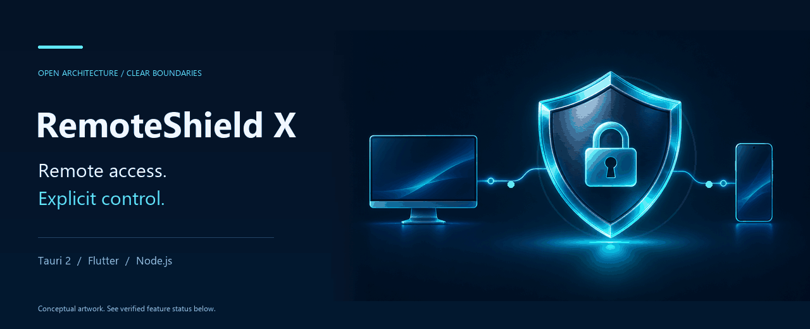
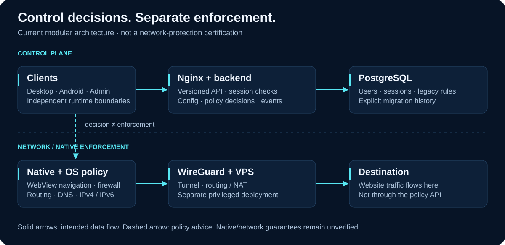
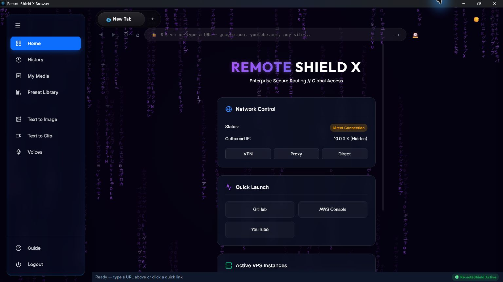
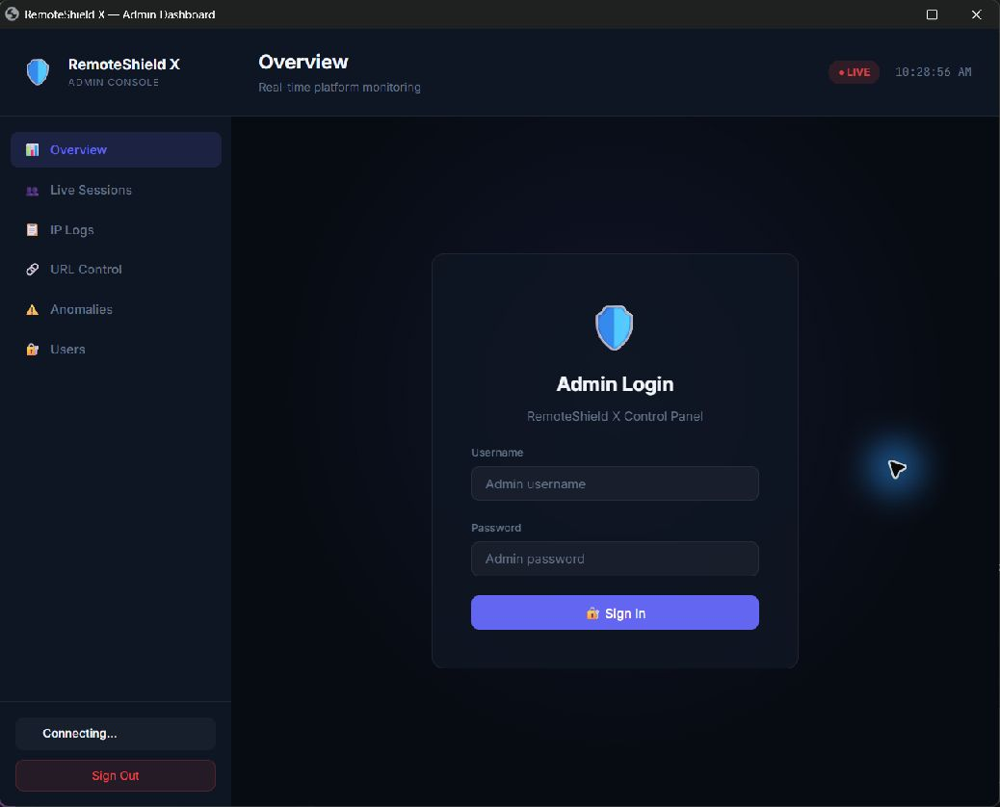
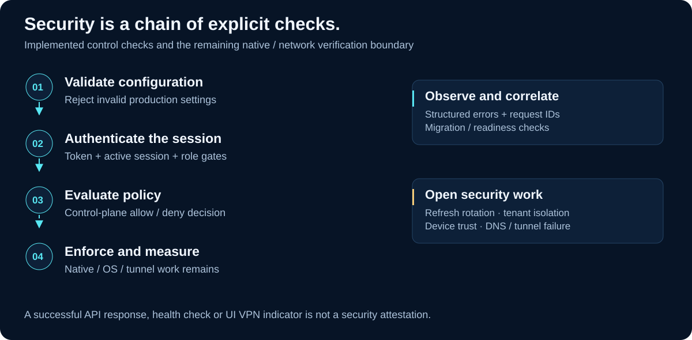
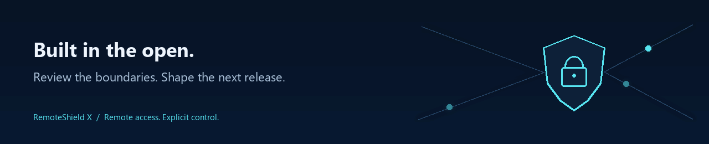

<picture>
  <source media="(prefers-reduced-motion: reduce)" srcset="assets/readme/remoteshield-hero.webp">
  
</picture>

# RemoteShield X

**Remote access. Explicit control.**

An open-source managed-browser and remote-access platform in development, with an explicit control plane and separate native/network enforcement boundaries.

[](https://github.com/manikantbindass/RdPBrowser/actions/workflows/architecture.yml)
[](docs/IMPLEMENTATION_STATUS.md)
[](docs/ARCHITECTURE.md)
[](contracts/API.md)

[Static edition — no animation](docs/README_STATIC.md) · [Local development](docs/LOCAL_DEVELOPMENT.md) · [Architecture](docs/ARCHITECTURE.md) · [Defect register](docs/BUG_REGISTER.md) · [Security policy](SECURITY.md)

> **Engineering status:** experimental, with verified architecture tests and incomplete platform/security features. This is not a production-ready security product. Artwork illustrates design intent; it does not demonstrate protection. The CI badge tracks the development branch, not a certification or release guarantee.

## Overview

RemoteShield X combines Tauri 2, Rust, React and TypeScript on desktop; Flutter/Dart on Android; and a Node.js/Express control plane backed by PostgreSQL. Socket.io carries realtime control events. WireGuard, OS networking and native browser adapters are separate enforcement concerns. Nginx and Docker package the control plane.

The repository is being improved incrementally. Existing API clients retain `/api` compatibility aliases alongside `/api/v1`. Configuration validation, request contracts, structured errors, migration history and readiness checks are implemented. Missing features and verification gaps are tracked openly.

## Feature status

| Capability | Current evidence | Status |
|---|---|---|
| Modular backend and validated configuration | Phase 04 unit/OpenAPI/PostgreSQL verification; architecture CI | Implemented |
| API v1, legacy aliases, structured errors | Shared JSON Schemas and compatibility tests | Implemented |
| PostgreSQL migration tracking and isolation | Adoption, concurrency, rollback/checksums, restricted-role RLS and cross-tenant tests | Implemented; production recovery drill pending |
| Desktop frontend and Windows native debug build | TypeScript/Vite, Rust test, formatting and Clippy | Build verified; runtime security unverified |
| Admin REST controls and realtime authentication | Tenant roles, live sessions, per-delivery revocation checks | Backend implemented; full admin UI acceptance pending |
| URL policy | Shared literal wildcard evaluator, revisioned storage, deny/allow parity | Backend implemented; client enforcement incomplete |
| Android application | Flutter browser, session and device enrollment, native VPN guard; signed ARM64 verification build | Implemented; managed device acceptance pending |
| Device registry and organization isolation | Tenant persistence, RLS/composite ownership, self-enrollment/revocation | Implemented; device attestation absent |
| VPN, DNS and kill-switch enforcement | WireGuard templates; native failure/bypass gaps | Unverified/incomplete |
| Refresh rotation | Persisted single-use refresh, session revocation and race tests; Android secure credential storage | Implemented; live Android session acceptance pending |
| Enterprise identity and access policy | OIDC/PKCE/signature checks, provider MFA assurance, refresh-family reuse detection, device key proof and live resource decisions | Backend implemented; live IdP/native handoff/attestation acceptance pending |
| Device trust and signed releases | Open defects and missing acceptance evidence | Incomplete |
| RDP, media/AI modules, offline audit sync | Placeholder UI or no implementation found | Not implemented |

See the [verified inventory](docs/IMPLEMENTATION_STATUS.md), [audit](docs/PROJECT_AUDIT.md) and [Phase 04 evidence](docs/PHASE04_REPORT.md). No all-traffic, screenshot-prevention, tamper-resistance, AI-detection or universal Android-compatibility guarantee is made.

## Architecture



The API authorizes and records control decisions. Browser content does not pass through `/api/proxy/navigate`; WebViews fetch it themselves. A health response or UI VPN indicator cannot establish tunnel routing or DNS isolation.

[Module ownership, dependency diagrams and data flows](docs/ARCHITECTURE.md) · [Architecture decisions](docs/adr/0001-modular-monolith.md) · [Enterprise extension boundaries](docs/INTEGRATIONS.md)

## Real application screenshots

### Windows desktop — existing native application



Captured from the running Tauri debug executable, not an AI mockup. This is the current development UI, not the new README design. Its placeholder IP/VPS data and status labels are not verified infrastructure or security signals.

### Admin frontend — real login view



Captured from the running, unmodified admin frontend in a clean browser profile. This is the login gate; no authenticated dashboard data or policy enforcement is demonstrated.

### Android and management capture gaps

See the [capture ledger](assets/readme/SCREENSHOTS.md) for actual captures and blockers. The admin frontend can display a real login view, but authenticated metrics and policy capture require a working database and an authorized admin session. A managed Android browser capture requires a provisioned test environment. An administrative device-management screen is not implemented.

## Security architecture



- Configuration rejects invalid production settings and ambiguous database TLS options.
- Protected REST and realtime paths verify active sessions; admin operations have role gates.
- Exact CORS origins and explicit trusted proxies replace loose origin/header trust.
- Errors carry server-owned request IDs; structured logs omit request bodies and redact credential fields.
- Explicit migrations precede startup. `/health` is liveness; `/ready` checks database/schema availability.
- Tenant-scoped database/service access and single-use refresh rotation have real PostgreSQL negative/race tests.
- Native enforcement, device attestation, external audit retention and remaining dependency findings require further work.

Development mode deliberately permits direct control-plane access. Experimental SSH is default-off and forbidden by production configuration. Read the [security policy](SECURITY.md) and [cutover requirements](docs/MIGRATION_PHASE04.md) before relying on any deployment.

[Identity flows and enterprise policy configuration](docs/IDENTITY_AND_ACCESS.md) · [Phase 05 verification and limitations](docs/PHASE05_REPORT.md). MFA/trusted-device requirements are explicitly configurable; the default legacy compatibility profile does not enforce them. Device key possession is distinct from hardware attestation and per-request token binding.

## Platform compatibility

| Target | Verified or configured | Limits |
|---|---|---|
| Windows desktop | Local native debug build and real UI capture | No signed installer or enforcement certification |
| Linux desktop | Tauri/WebKitGTK target; prior build workflow evidence | Current runtime/distro acceptance not established |
| macOS desktop | Universal target configured | Current signing/notarization/runtime acceptance not established |
| Android | Minimum API 26; target and compile API 36; signed ARM64 verification APK; Android 16 emulator smoke test passed | Physical device matrix, production signing and provisioned VPN acceptance pending |
| Backend | Local Node24 checks; Node22 architecture CI/container | Original dependency findings remain open |
| PostgreSQL/Nginx/Docker | Real integration and earlier healthy local stack | Final local rerun blocked by Docker Desktop availability; production TLS not certified |

[Dependency and toolchain matrix](docs/DEPENDENCY_MATRIX.md) · [Releases](https://github.com/manikantbindass/RdPBrowser/releases) — release existence does not prove signing, security or compatibility.

## Installation and local development

Prerequisites: Node22, Git, Docker in Linux-container mode and Compose>=2.24.4. Native desktop builds additionally need the appropriate Rust/Tauri OS toolchain. Existing configuration is never overwritten automatically.

```powershell
git clone https://github.com/manikantbindass/RdPBrowser.git
cd RdPBrowser
# Until this development branch is merged:
git switch codex/remoteshield-enterprise-completion
node scripts/setup-dev.mjs
npm ci --prefix backend
npm ci --prefix desktop
npm run config:check --prefix backend
```

On Windows Docker Desktop, select the Linux context for this shell:

```powershell
$env:DOCKER_CONTEXT='desktop-linux'
```

Follow [Local development](docs/LOCAL_DEVELOPMENT.md) for host-side hot reload, native builds, test-database setup and endpoint configuration. [Android operations](docs/ANDROID_OPERATIONS.md) covers the Flutter toolchain, WireGuard setup and signing. Generated credentials remain ignored; do not commit `.env` files. No default administrator account is provided.

## Docker and VPN setup

```powershell
docker compose --env-file docker/.env -f docker/docker-compose.yml -f docker/compose.dev.yml config --quiet
docker compose --env-file docker/.env -f docker/docker-compose.yml -f docker/compose.dev.yml up -d --build --wait
```

The local stack sequences PostgreSQL, migrations, backend readiness and Nginx. Development ports bind loopback: backend 3001, admin 8180 and PostgreSQL 5432. The profile explicitly disables the API VPN source filter; it is not a production security setup.

Production uses the base Compose file with reviewed secrets, a deliberate DB trust model, actual TLS certificates and verified ingress addresses. Read the [migration/recovery guide](docs/MIGRATION_PHASE02.md) before mapping existing data volumes. Never delete volumes as routine recovery.

WireGuard templates live in [vpn-server/](vpn-server/). The privileged [setup script](vpn-server/setup.sh) changes packages, keys, firewall and routing; it is not idempotent and should not be run blindly on a working VPS. [Audit findings B41–B43](docs/BUG_REGISTER.md) describe the provisioning and DNS/IPv6/failure gaps. A configured tunnel is not proof of a working kill switch.

## API and administration

New clients use `/api/v1`; existing `/api` aliases remain. Login and navigation requests share language-neutral JSON Schemas. Errors retain `error` and add `code` and `requestId`. Socket.io clients supply `auth.token`.

| Entry point | Purpose |
|---|---|
| `/api/v1/meta` | Public API metadata; enforcement reported as external |
| `/api/v1/auth/*` | Persisted registration/login sessions and single-use refresh rotation |
| `/api/v1/admin/*` | Role-gated sessions, rules, users and audit views |
| `/api/v1/proxy/navigate` | Policy approval, not content proxying |
| `/api/v1/devices`, `/sessions`, `/policies`, `/events` | Tenant-aware backend registry, lifecycle, decisions and event intake |
| `/health`, `/ready` | Independent process/dependency observations |
| `/admin/` | Existing web administration frontend |

[API inventory](contracts/API.md) · [OpenAPI specification](contracts/openapi.json) · [Domain contracts](contracts/README.md) · [Admin source](admin-dashboard/) · [Integration ports](docs/INTEGRATIONS.md)

## Testing

```powershell
npm run lint --prefix backend
npm test --prefix backend -- --runInBand --detectOpenHandles
npm run build --prefix desktop
cargo fmt --manifest-path desktop/src-tauri/Cargo.toml -- --check
cargo test --locked --offline --manifest-path desktop/src-tauri/Cargo.toml
cargo clippy --locked --offline --manifest-path desktop/src-tauri/Cargo.toml --all-targets -- -D warnings
```

A fresh Rust cache needs `cargo fetch --locked` before offline checks. Real integration tests require an explicit disposable PostgreSQL database ending in `_test`; see the [test instructions](docs/LOCAL_DEVELOPMENT.md). The [architecture workflow](.github/workflows/architecture.yml) runs blocking unit/contract and PostgreSQL tests. Older release workflows still contain ignored failures; a green job alone is not a security assessment.

Visual assets can be rebuilt and checked without production services:

```powershell
python -m pip install -r scripts/requirements-readme.txt
python scripts/build_readme_assets.py
python scripts/validate_readme.py
```

## Roadmap

1. Verify Android deployment with a provisioned backend, WireGuard lockdown and production signing on physical devices.
2. Review remaining dependencies, production role provisioning and authentication operations.
3. Verify managed native navigation, tunnel failure, DNS and IPv6 behavior per platform.
4. Complete device attestation, client policy enforcement and safe administration UI flows.
5. Establish signing, performance, audit retention and tested recovery targets.

[Prioritized roadmap](docs/ROADMAP.md) · [Defect register](docs/BUG_REGISTER.md) · [Current phase reports](docs/)

## Contributing and security policy

Use focused changes, preserve existing clients, add meaningful regressions and document platform limits. Never bypass analyzers or replace enforcement with a UI signal. See [CONTRIBUTING.md](CONTRIBUTING.md) and [SECURITY.md](SECURITY.md).

Package metadata declares MIT, but the repository does not currently contain a standalone license text. Do not treat a badge as a substitute for that missing document; the owner must resolve the licensing record.

[Brand/media provenance and reproduction](assets/readme/README.md) · [Repository description and topic recommendations](docs/REPOSITORY_METADATA.md)

<picture>
  <source media="(prefers-reduced-motion: reduce)" srcset="assets/readme/remoteshield-footer.webp">
  
</picture>
