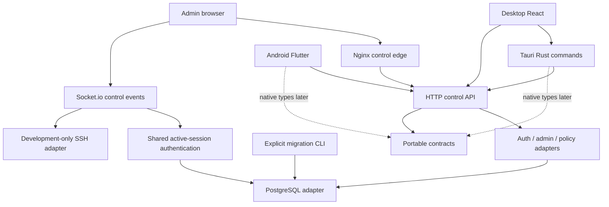
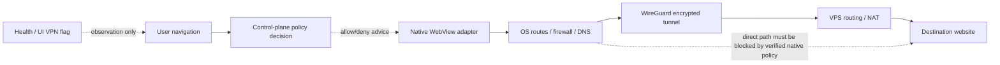
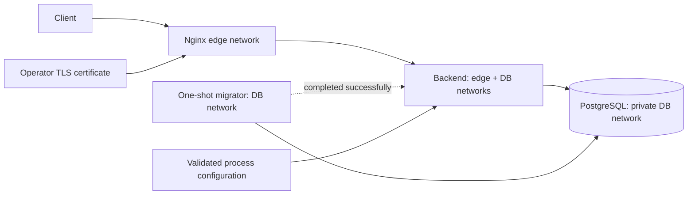

# RemoteShield X architecture

Phase 02 evolves the existing stack into a modular control-plane backend and explicit client/network/deployment boundaries. One Node/Express deployable and PostgreSQL remain; no broker, Redis, Kubernetes or microservice split is introduced. The Phase 01 audit remains historical evidence; current changes/limits are in PHASE02_REPORT.md.

## Component ownership and dependencies

| Boundary | Owns | Must not claim / depend on |
|---|---|---|
| desktop/ | Rust/Tauri process and native adapters, React/TypeScript UI, public endpoint config | Backend internals or proof of OS routing from a health response |
| android/ | Dart/Flutter UI/state and native platform channels | npm/Rust runtime dependency; currently missing screens/native implementation remain open |
| backend/ | Config/contracts, HTTP/realtime composition, auth/policy/admin adapters, SQL and lifecycle | Client UI imports or packet-level tunnel enforcement |
| admin-dashboard/ | Browser admin presentation using control API and Socket.io | Direct DB access, client-authoritative roles or simulated infrastructure inventory |
| contracts/ | Versioned JSON Schema DTO/request/error definitions | Secrets, executable platform implementation or proof of tenant isolation |
| vpn-server/ | Privileged WireGuard/route/firewall/DNS provisioning | Automatic execution by control-plane startup; scripts require separate OS-specific verification |
| nginx/,docker/ | Edge TLS/routing, process packaging, development isolation, migration sequencing | Browser content proxy, VPN attestations or embedded signing credentials |
| security/ | Optional local detector and integrity utility | AI/durable audit/export or signing guarantees unsupported by tests |



Existing route modules retain the database facade while the composition root is separated. This is incremental architecture, not a claim that every route already uses a complete repository/service layer. Config/logging are process concerns; bootstrap imports do not connect, migrate or listen. Optional detector has an explicit stop handle. Runtime starts only after DB/migration verification and closes sockets/pool on shutdown.

## Control-plane data flow

```mermaid
sequenceDiagram
  participant Client as Desktop / Android / Admin
  participant Edge as Nginx edge
  participant API as Express HTTP
  participant Contract as Shared schema validator
  participant DB as PostgreSQL
  Client->>Edge: HTTPS /api/v1 request
  Edge->>API: Forward request; overwrite proxy headers
  API->>API: Generate request ID, exact CORS/rate/source checks
  API->>Contract: Validate request DTO
  Contract-->>API: Accepted or typed validation error
  API->>DB: Verify active session; query/update state
  DB-->>API: Result
  API-->>Client: Compatible success or error + code/requestId
  Note over API,DB: /ready verifies dependency and migration history
  Note over Client,API: /api remains a compatibility alias
```

Public endpoints: /health liveness, /ready dependency readiness, /api/v1/meta API metadata, existing /api[/v1]/laila search. Auth/admin/policy routes use configured source filtering; protected routes use token/session verification; admin routes also check roles. Socket.io separately reuses active-session authentication. No implicit REST authentication is assumed to cover sockets.

## Network traffic flow and enforcement ownership



The API is not in the website-content path. Native redirect/subresource interception, tunnel/DNS/IPv6 failure behavior, screenshot restrictions and tamper-resistant device trust remain platform work. Existing bypass/fail-open risks remain documented. The development profile deliberately permits direct control-plane access and must never be presented as managed security.

## Domain and persistence

contracts/README.md maps organization/user/device/session/policy/event DTOs to existing tables and missing future persistence. No organization/device registry/tenant migrations are introduced. The only migration is the existing schema baseline plus the migration ledger. Nullable legacy fields need deliberate migration before tenant APIs can be exposed. Events are versioned DTO designs, not a durable queue.

## Deployment topology



Local override publishes PostgreSQL5432, backend3001 and Nginx8180 only on127.0.0.1. Production base publishes only Nginx80/443. Nginx cannot directly reach PostgreSQL's private network. Compose uses health and migration completion dependencies; probes use installed Node, not missing curl. Images use tested digests, backend/root module layout is preserved in /app, and .dockerignore excludes secrets/caches. Production certificates, source topology, least-privilege DB roles and routing still need deployment review.

See LOCAL_DEVELOPMENT.md for executable setup/checks, MIGRATION_PHASE02.md for compatibility/cutover, INTEGRATIONS.md for extension ports, and adr/0001–0005 for decisions/tradeoffs.
