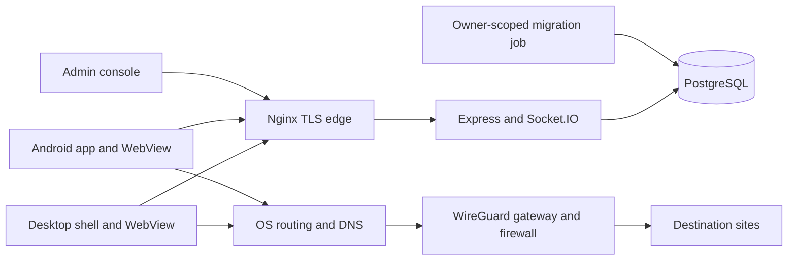
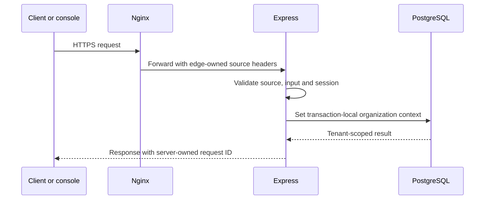

# Architecture

RemoteShield X is a modular monolith with native clients and a separately operated network enforcement layer. The architecture described here matches the branch verified by [Phase 14](PHASE14_REPORT.md). The [ADR index](adr/0001-modular-monolith.md) records the original monolith decision.

## Component ownership

| Component | Technology | Responsibility |
| --- | --- | --- |
| Desktop | Tauri 2, Rust, React, TypeScript, Vite | Trusted shell, native browser windows, client state, policy and session checks, and guarded downloads and updates |
| Android | Flutter, Dart, WebView, Kotlin bridge | Session lifecycle, Keystore enrollment, browsing UI, and OS network observations |
| Administration | Same-origin browser console | Tenant operations, policy revisions, alerts, integrations and evidence |
| Control plane | Node 24, Express, Socket.IO | HTTP and realtime authorization, server-owned decisions, persistence and telemetry |
| Persistence | PostgreSQL 15, explicit SQL migrations | Checksummed schema, transaction-scoped tenant context, constraints and forced row-level security |
| Packet enforcement | WireGuard, Linux nftables and Unbound, managed OS policies | Peer identity, routing, DNS, forwarding and failure behavior |
| Infrastructure | Nginx, Docker Compose, optional Terraform | TLS, service networks, resource limits, backup and deployment tooling |

Client-to-edge arrows represent logical control requests. In a managed tunnel deployment the control requests also traverse WireGuard. The website-content path runs from the native WebView through the OS and gateway to the destination. The API navigation endpoint supplies a policy decision.

## Request lifecycle

The middleware ordering places root probes and separately scoped SCIM routes outside the end-user source gate. Public metadata and the compatibility search route also have distinct admission. Protected operations verify the live account, organization and session, then apply role or resource policies. Socket.IO checks active sessions on its own connection path. Consult the [API reference](API_REFERENCE.md) for exceptions and URL prefixes.

## Data model and trust boundaries

An organization owns users, devices, sessions and policies. A device’s enrollment, public key and approval state are separate. A session links a subject to its live organization and can be revoked independently. Policies carry revisions and assignment scope. Events and canonical audit rows distinguish source and action, including lower-confidence client observations. Directory mappings and SMTP-free in-app incident notifications reuse this model.

Migration 002 adopts legacy rows into tenant ownership. Later migrations add identity, native client policy state, detections and governance. The deployment migrator applies ordered checksums and grants. The service checks schema history before readiness. The runtime role cannot own application tables or bypass RLS. [SQL migrations](../backend/src/db/migrations/) · [Contracts](../contracts/)

The backend composition root wires validated configuration, HTTP, realtime, optional detection and lifecycle management. Reusable services handle access decisions, organization lifecycle and alert processing. The TypeScript, Rust and Dart clients use their native representations of stable JSON/HTTP contracts.

## Deployment boundary

The base Compose topology has an edge network and a private database network. Nginx and the database have no direct network path through Compose. The backend is the application bridge. The migrator uses separate owner credentials. The deployment overlay limits mounts, capabilities and exposed ports. The optional SCIM edge has a separate public ingress. Logs, backup transport, provider setup and gateway state require operator ownership. [Deployment](DEPLOYMENT.md) · [Integration extension points](SECURITY_MODEL.md)
