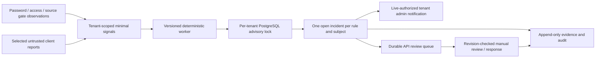

# Deterministic security detection and response

Phase 10 provides explainable rules in the existing Express/PostgreSQL deployment. It does not introduce a machine-learning model, external notification provider or automatic account containment. The source-gate, identity and URL policies continue to enforce access independently of this optional detector.

## Enable and deploy

1. Back up the database and verify restoration in a disposable environment. Schedule a maintenance window for the table locks and indexes in migration `005_detection_response.sql`. Preserve the previous artifact and configuration.
2. Stop writers, deploy the new artifact, then run `npm run migrate --prefix backend` with the separate migration credentials described in [the database upgrade guide](MIGRATION_PHASE04.md). Rerun runtime-role provisioning: the new evidence and review tables must deny runtime UPDATE/DELETE. Do not give the application migration or owner credentials.
3. In the private backend environment, or ignored `docker/.env`, set the following deliberately. Compose passes all four settings to the backend. No credentials are needed beyond existing secrets.

```dotenv
ANOMALY_DETECTION_ENABLED=true
ANOMALY_ORGANIZATION_IDS=00000000-0000-4000-8000-000000000001
DETECTION_INTERVAL_MS=30000
DETECTION_SIGNAL_RETENTION_DAYS=7
```

The organization allowlist contains comma-separated UUIDs, at most 100, without spaces. The scan interval accepts 1,000–300,000 milliseconds; signal retention accepts 1–30 days. Defaults leave collection and scanning disabled. Add each real organization explicitly. Restart the backend after changing configuration. Verify `/ready`, sign in as a tenant administrator and inspect Risk & alerts → Detection health. `disabled`, `not_started`, `lagging`, `failed` and `capacity_exceeded` are explicit states; a healthy HTTP process alone does not establish detector health.

The migration preserves old alerts and resolved flags. Legacy `/api/admin/anomalies` and `/api/v1/admin/anomalies` still list unresolved records. Their resolve endpoint keeps its response and `anomaly.resolve` audit action, and now writes a structured review with disposition `insufficient_evidence`. New APIs use revision checks. Existing source, authentication, session, URL policy and event DTOs are preserved.

To recover from worker trouble, disable the flag and restart; inspect structured `detection.*` failures without exposing secrets. When collection is enabled, its write failures fail the associated authenticated operation closed, adding a database availability dependency. Collection is not buffered or silently dropped. A denied source-gate request always remains denied even if its observation cannot be stored; this failure is logged. Refresh-token reuse first commits its required family revocation and existing audit, then attempts the optional observation: a signal-write failure is logged and cannot undo revocation. Disabling the flag pauses both collection and retention cleanup, so the signal retention period is not a hard deletion SLA during downtime or disablement.

Use a forward fix for migration problems. Previous artifacts do not understand migration 005 or the new resolved/status constraint. Binary-only rollback is unsupported: restore the verified pre-upgrade backup in the maintenance window, accepting the documented recovery-point loss, or deploy a compatible forward repair. Do not drop tables or edit applied migration checksums.

## Signal provenance and rules

All windows use backend/database observation time. Client `occurredAt` never controls detection timing. The engine is in `security/anomaly-detector/rules.js`; thresholds, explanations, confidence and rule version are returned by `GET /api/v1/admin/detection-rules`. Version 1 rules are:

| Rule | Observation and threshold | Window | Severity / confidence |
|---|---|---|---|
| auth_failures | Five failed password credential checks for one account target | 5 min | High / medium |
| password_spray | Ten distinct account targets failing from one observed source | 10 min | High / medium |
| session_source_change | Two observed sources for one authenticated session | 10 min | Medium / low |
| device_identifier_change | Two asserted device IDs across successful password logins for a user | 10 min | Medium / low |
| policy_denials | Three server authorization or recorded URL navigation denials for a user | 5 min | Medium / medium |
| access_volume | One hundred authenticated HTTP observations for a user | 1 min | Medium / low |
| refresh_reuse | A previously consumed refresh token is presented again | 5 min | High / high |
| vpn_source_rejected | A live signed access session reaches the protected API outside the approved source network | 5 min | High / medium |
| vpn_client_disconnected | Authenticated `vpn.disconnected` client report | 5 min | Medium / low |
| vpn_client_bypass | Authenticated `vpn.bypass_suspected` client report | 5 min | High / low |

Confidence describes the observation, not compromise probability. High-confidence token reuse can still result from a legitimate refresh retry. Shared NAT/VPN gateways, roaming, multiple devices, repeated client polls and administrative automation can trigger other rules. There is no arbitrary UTC office-hours rule or inferred impossible-travel claim.

Client reports use the existing idempotent `POST /api/v1/events` contract. Only the two listed event types feed these rules; the engine ignores client-provided severity and stores `client_report` provenance. Repeated submission of a `clientEventId` does not duplicate its signal. Other security events remain visible in the event explorer. Native applications are not changed to automatically submit these reports in this phase. Operators must integrate a verified event source before expecting client disconnection alerts. Offline clients cannot report until connectivity returns; absence of a report is not evidence of a healthy VPN.

Password failures refer to an account target, including nonexistent usernames, not an authenticated actor. Unknown organizations, invalid/malformed/expired tokens, OIDC provider failures, rate-limited requests and source rejections without a live signed session are not attributed to tenant incidents. Existing denial logs still apply. Device strings are untrusted assertions; these rules do not establish key possession, hardware posture, root state or attestation. No OS-wide flow, DNS leak, gateway packet, browser subresource or WebSocket message inspection is performed. A rejected API source indicates a routing/configuration issue or suspicious access; it does not prove all traffic bypassed a tunnel. See [network assumptions](NETWORK_PROTECTION.md).

## Deduplication, audit and review



Each scan atomically commits the incident, evidence, rule-trigger audit and worker-health record. A tenant advisory lock and partial unique index prevent concurrent workers creating duplicate open incidents. Evidence is consumed once per rule, so repeated scans do not inflate counts. Further qualifying batches attach to the same open/investigating incident. Closing an incident does not allow old consumed evidence to alert again: a new incident requires fresh observations meeting the threshold. This also means a single new source or device after consumption may not requalify until another distinct value is observed. No cooldown hides the existence of a newer qualifying batch.

The scanner caps input at 2,000 observations per rule per scan. An extra row marks `capacity_exceeded`; there is no complete-coverage claim under overload. Large sets of below-threshold subjects can delay other subjects until their window expires. Review capacity, collection volume and retention before deployment. The 15-second SQL timeout remains in effect; scan failure rolls back the batch and marks health failed where the database permits. Shutdown waits for in-flight work before closing the pool. Multiple workers are serialized per tenant; this is not a throughput scaling solution.

Incident states are `open`, `investigating`, `resolved`, `dismissed`. Active states require `pending` disposition; closed states require `confirmed`, `benign` or `insufficient_evidence`. Investigating/closed reviews record their administrator; reopening clears assignment. Review/response writes require the current `review_revision`; conflicts return 409. A closed incident cannot reopen while a newer open incident exists for the same rule/subject. The legacy resolve alias intentionally retains its older last-writer behavior.

Administrators may manually terminate a linked session or lock the associated account and revoke all its sessions. These operations are transactional with review and audit, obey tenant and existing role hierarchy restrictions, and never follow directly from a detection. Peer administrators, superadministrators and self-lock actions remain protected. Authentication-failure incidents identify the targeted account, so review attribution before containment. Account unlock uses the existing user controls and does not revive revoked sessions. Quarantine/revoke device actions remain in the device console.

`security_alert` Socket.IO notifications contain only incident ID, rule ID and severity. Delivery rechecks the live session, role and organization. Notifications are best effort to currently connected administrators, once when the incident opens. Delivery failures are logged; no email, push, webhook or external messaging is configured. Reconnects do not replay notifications. The persistent queue is the recovery path; the alerts page also polls every 90 seconds while idle and visible. Use Refresh for immediate review. Evidence and review tables paginate at a default 50 and maximum 100 rows; the console uses pages of 20. No free-text incident notes are collected.

## API and verification

All routes require live tenant administrator authorization. Ordinary users receive 403; another tenant's incident detail/review/response receives 404. Existing `/api` aliases remain. See the generated [OpenAPI](../contracts/openapi.json).

| Method / path under `/api/v1` | Purpose |
|---|---|
| GET /admin/detection-rules | Definitions, effective enablement, interval, last attempt/success and health |
| GET /admin/alerts | Queue; bounded `page`, `limit`, `status` (default open; accepts all), `severity`, `ruleId` |
| GET /admin/alerts/:id | Explanation, confidence, provenance summary, timestamps and review revision |
| GET /admin/alerts/:id/evidence | Paginated immutable evidence with observation time, trust, reason and request ID |
| GET /admin/alerts/:id/reviews | Paginated immutable review/response history |
| PATCH /admin/alerts/:id/review | `{revision,status,disposition}` |
| POST /admin/alerts/:id/respond | `{revision,action}`; action `terminate_session` or `lock_user` |

From the repository root, with Node 22, lockfile dependencies and a disposable PostgreSQL 15 database:

```powershell
npm ci --prefix backend
npm ci --prefix admin-dashboard
npm run lint --prefix backend
npm test --prefix backend -- --runInBand --detectOpenHandles
node scripts/build-openapi.cjs
node backend/src/validate-openapi.js
node scripts/evaluate-detections.cjs
npm test --prefix admin-dashboard
# Set INTEGRATION_DATABASE_URL privately to an owner-capable disposable database ending _test.
npm run test:integration --prefix backend
# Install Playwright Chromium, or set ADMIN_CHROME_PATH to an installed Chrome executable.
Set-Location admin-dashboard
npx playwright install chromium
npm run test:browser
```

Integration tests create unique schemas and restricted runtime roles, then clean them up. They do not alter host routing, firewall, DNS or existing application data. CI runs the same suites on PostgreSQL 15 and Chromium. The browser fixture is labeled Console verification lab; its synthetic records never ship as live application metrics.

## Privacy, evaluation and remaining acceptance

New signals contain event type, tenant/user/session references, server request ID, fixed reason and trust codes, timestamps, and tenant-scoped HMAC-SHA256 fingerprints of subject/source/asserted device. They exclude usernames, raw IP addresses, full URLs, passwords, tokens and VPN keys. HMAC domain separation uses the existing access-signing secret; rotating it breaks correlation across the rotation window. It is pseudonymization, not anonymization. Restrict API/database access, protect the signing secret and review data residency and retention. Existing audit/IP tables can still contain addresses and sanitized URL paths under their own retention policy; this phase does not silently rewrite them.

Successful scans delete raw signals older than the configured retention period. Evidence preserves event/trust/reason/request/time, excluding source/device fingerprints, and has no signal foreign key so deletion preserves incident history. Evidence, reviews and existing audit records deny runtime modification/deletion; database owners remain trusted and can alter them. No external immutable archive, legal-hold mechanism, automatic incident-history purge, SIEM exporter or privacy erasure workflow is claimed. Establish those operator policies before production rollout.

No labeled production dataset was found. The optional research model is therefore deferred. Fifty explicitly synthetic stress fixtures cover ten rules: one observed attack, below-threshold benign case, expired benign case, legitimate confounder with the same observations and attack without telemetry for each rule. The evaluation reports 10 true positives, 20 true negatives, 10 false positives and 10 false negatives: precision 50%, recall 50%, fixture false-positive rate 33.3%, fixture false-negative rate 50%. These intentionally selected cases demonstrate limitations; they are not estimates of production accuracy or a tuned benchmark.

Fixture observation-to-scan latency is modeled at one second. An actual local PostgreSQL 15.19 load scan of 2,001 synthetic observations took 1,880 ms, recording the incident 1,571 ms after the source observations, and reported its 2,000-row cap. This manual scan excludes scheduler wait, transport, missing telemetry and notification delay. Default scheduler wait can add roughly 0–30 seconds plus scan time under healthy low load, with no latency SLA under database errors or overload. Offline reports and attacks below the thresholds may never alert. Evaluate tenant-specific labeled activity, false positives/negatives, peak load, operational response times and privacy controls before enabling broadly. There is no production-ready AI detection claim.
