# Identity and Zero Trust access controls

Phase 05 adds server-side identity/access controls within the existing Express/PostgreSQL monolith. It does not certify endpoint integrity or provide blanket Zero Trust protection. See [OpenAPI](../contracts/openapi.json), [phase report](PHASE05_REPORT.md) and [prior database role upgrade](MIGRATION_PHASE04.md).

## Upgrade and compatibility

Back up and restore-test before a deployment. Apply checksummed `003_identity.sql` using operator migration credentials, then reapply runtime grants with the existing migration/provisioning command. Never edit migration001/002 or disable RLS to pass readiness. Migration003 preserves users/password hashes, tenant ownership, API aliases and existing role names. Existing sessions receive an absolute expiry from their previous refresh/access expiry and their original start time as authentication time; they do not become MFA-verified or trusted devices. Device rows start `unknown`, with existing revoked devices retained as revoked. New tables also use forced RLS and tenant ownership foreign keys. Access decisions are append-only to the runtime role.

The current policy defaults to a named **legacy compatibility profile** when no access_policies row exists: existing roles/methods permitted, MFA/device posture requirements off, absolute session age at most seven days, idle timeout24h, proof freshness15min and MFA freshness1h. Production administrators must deliberately configure reviewed enterprise requirements. This preserves working password clients; it is not a claim that every deployment automatically requires MFA or trusted hardware.

Refresh now preserves its family, authentication/MFA time, device proof and absolute expiration rather than extending them indefinitely. A previously consumed refresh credential is a compromise signal that revokes that entire family. Concurrent refreshes may therefore force reauthentication even when one request initially succeeds. Clients must serialize refresh, replace both tokens atomically, and reauthenticate on 401/403 instead of retrying a consumed credential. Already-revoked tokens remain unusable; expired access tokens may refresh only while the stored refresh credential, account, idle/absolute lifetime and current policy permit it. A failed refresh policy check consumes/revokes the attempted session; it cannot mint a bypass session.

## Identity and OIDC flow

```mermaid
sequenceDiagram
  participant B as Browser
  participant A as RemoteShield API
  participant D as PostgreSQL
  participant I as Enterprise IdP
  B->>A: GET auth/oidc/provider/start
  A->>I: HTTPS issuer discovery
  A->>D: Store hashed state/browser binding, encrypted PKCE+nonce, 5min TTL
  A-->>B: Secure HttpOnly SameSite=Lax cookie; 303 authorization URL
  B->>I: Authorization code + PKCE S256 + nonce + max_age
  I-->>B: GET callback with code/state
  B->>A: Callback + same browser cookie
  A->>D: Atomically consume exact tenant/provider/state/browser binding
  A->>I: Exchange code with verifier and confidential client authentication
  A->>I: Verify RS256 signature via JWKS; issuer/audience/nonce/time checks
  A->>D: Resolve exact issuer/subject link and live local user/role
  A->>D: Evaluate policy, persist local session and audit atomically
  A-->>B: Local tokens in no-store JSON body, never redirect URL
```

The adapter uses pinned openid-client6.8.9, explicit signature verification (`enableNonRepudiationChecks`), code flow only, PKCE S256, state, nonce and an exact configured HTTPS callback. Cookie prefix __Host forbids Domain and uses Path=/, Secure, HttpOnly and SameSite=Lax. Query response mode only; form_post/implicit/hybrid/native custom redirect schemes are not supported. A browser has one current SSO flow cookie; starting another flow replaces the binding. State is single-use even when provider processing fails, expires in five minutes and is scoped to provider+organization. PKCE/nonce context is AES-256-GCM encrypted with a distinct operator state key. Upstream operations have five-second deadlines; errors omit provider bodies/codes/tokens.

Provider discovery/JWKS endpoints are trusted operator configuration, never arbitrary request URLs. HTTPS verification is not disabled. Use an egress policy appropriate to your IdP. Only RS256 signed ID tokens are supported by this profile. ID-token issuer/audience/signature/nonce/expiry and authentication time are checked; email, groups and provider roles never grant a local identity or role. IdP access/refresh/ID tokens are not stored or returned to clients. Local tokens still require a live organization, active/unlocked local user and live database session.

### Operator configuration

1. Register a confidential web OIDC client at your provider, with exact redirect `https://<server>/api/v1/auth/oidc/<provider-id>/callback` and code/query flow. Enable PKCE S256, appropriate tenant-specific issuer and the reviewed MFA/Conditional Access provider policy. Do not place its client secret in Tauri, Flutter, VITE variables, Git or logs.
2. Copy [oidc.providers.example.json](../backend/oidc.providers.example.json) into ignored `.local-tests/oidc/providers.json` or a deployment-secret path. Replace issuer/clientId/organizationId/redirectUri. The example has **no production credentials and no assumed MFA mappings**. Each `clientSecretEnv` names a privately supplied environment variable. `OIDC_PROVIDERS_FILE` selects this operator file; unset means SSO disabled. `OIDC_STATE_KEY` is an independent random32-byte hex key, distinct from signing secrets. Rotating it invalidates pending five-minute SSO transactions; existing local sessions are separate.
3. Map verified provider assurance with `mfaAcrValues` and/or `mfaAmrValues`. These values must have documented MFA meaning under that provider's configured policy. A signed `pwd`/password claim is not MFA. Merely requesting acr_values or having an enabled MFA checkbox does not establish the required assurance. Missing/unmapped claims produce mfa_verified=false; a local MFA-required policy denies the session. No vendor-wide claim assumption is supplied.
4. Provision a local user in the correct organization. An authenticated local admin uses POST `/admin/identity-links` with `{userId,providerId,subject}` to bind the exact stable provider subject/issuer. Subject is not an email lookup. Links cannot be silently reassigned; unlinking revokes enterprise sessions. Provider registration and initial admin provisioning remain trusted operator actions. Do not let untrusted administrators configure issuer endpoints or map subjects they have not verified.
5. Perform a real-provider login and policy activation exercise before enforcing MFA. GET/PUT `/admin/access-policy` uses optimistic revisions. The server refuses MFA/SSO-only activation without a configured assurance-capable linked admin and refuses trusted-device activation without an approved/proven administrative device. These checks reduce bootstrap errors; they cannot prove the IdP is available or that its Conditional Access rules are configured correctly. Keep documented out-of-band operator recovery access.

For Compose, use a private override to mount the provider file read-only into **backend only** and inject the provider-specific secret environment there. For example:

```yaml
services:
  backend:
    environment:
      OIDC_PROVIDERS_FILE: /run/remoteshield/providers.json
      REMOTESHIELD_ENTERPRISE_CLIENT_SECRET: ${REMOTESHIELD_ENTERPRISE_CLIENT_SECRET:?Supply privately}
    volumes:
      - ./private/providers.json:/run/remoteshield/providers.json:ro
```

Resolve the host mount relative to the Compose project and keep the actual override/provider files ignored or outside the repository. Base Compose passes no SSO file/state key to the migrator; the runtime receives configured state key/path only. The provider secret must be injected explicitly by the private override/secret manager. Set OIDC_STATE_KEY privately. Do not print expanded Compose environments. SSO requires a real HTTPS frontend/proxy even in development; the HTTP-only local profile is not an SSO acceptance environment. No generated provider configuration or secret is bundled into the backend image.

Okta and Microsoft Entra ID are future standards-based profiles through this adapter, not vendor SDKs or verified tenant presets. Use each registered issuer exactly; Entra common/organizations wildcard issuers are not accepted as tenant substitutes. Assurance claims and token versions vary: if the chosen provider profile does not emit suitable validated acr/amr, strict MFA fails closed. Provider-specific Conditional Access/authentication-context extensions, SCIM and backchannel logout require future adapters and real tenant acceptance. No live Okta/Entra credentials/tenant were supplied in this phase.

### Client boundary

The callback returns JSON local tokens to the HTTPS browser. Existing password clients/aliases still work under compatibility policy. A native-app external-browser handoff and SSO login UI are not implemented in this backend phase; do not copy tokens into redirect query strings or bundle the confidential secret into a native app to bridge that gap. Future native integration needs a reviewed short-lived, PKCE-bound local handoff/deep-link contract and secure OS storage. Browser/admin frontends also need a reviewed token storage and CSP/XSS design. No frontend SSO completion is claimed here.

## Policy decision model and enforcement

Every authenticated REST/realtime decision uses current database user/role, organization, session and device data, not client assertions. The server classifies resources:

| Resource | Sensitivity / gate |
|---|---|
| auth.login | Low; permits a policy-restricted session to complete device proof |
| device.enroll | Low; authenticated owner bootstrap only; MFA/auth-method policy still applies |
| session.terminate | Low; live users may terminate themselves after policy tightening |
| session.manage, browser.navigate | Medium; normal method/MFA/device/session policy |
| events.ingest, realtime.connect | Low; normal policy and own/tenant checks |
| admin.manage | High; current admin/superadmin role plus high-sensitivity policy |

Explicit denial reasons include inactive identity, organization mismatch, revoked/absolute/idle-expired session, role/method denial, missing/stale provider MFA, invalid device/owner and missing/stale trusted possession. Unknown resources deny. A client can request an advisory decision through POST `/access/evaluate` using a server-defined resource name; it cannot supply identity, role, sensitivity, device status or policy overrides. The same model gates actual protected routes. URL-policy evaluation remains separate and does not bypass identity gates. Device bootstrap exceptions are limited to authenticated enrollment/proof operations; there is no anonymous trust grant.

Configuration fields: allowedRoles/allowedAuthMethods, requireMfa, highSensitivityRequireMfa, requireTrustedDevice, sessionMaxAgeSeconds(300..604800), idleTimeoutSeconds(60..86400), maxProofAgeSeconds(60..86400), maxMfaAgeSeconds(60..86400). PUT requires the previous revision and a complete typed configuration. The current administrator must satisfy the proposed high-sensitivity policy before activation, including fresh provider MFA and fresh/nonexpired device posture/proof when required; mere provider configuration or stale enrollment cannot activate an inaccessible policy. No organization-wide superadmin bypass exists. Account/role/organization/session/device changes apply on the next decision, including sensitive realtime deliveries. Idle activity advances on successful authentication, not absolute or MFA time. Revoked subscriptions are disconnected before sensitive admin messages.

## Device enrollment and trust

```mermaid
stateDiagram-v2
  [*] --> unknown: Self-register external ID (untrusted)
  unknown --> unknown: Enroll immutable P-256 public key / prove possession
  unknown --> approved: Reviewed admin approval + bounded posture validity
  approved --> quarantined: Noncompliance / suspected compromise
  approved --> revoked: Revoke
  quarantined --> approved: Reviewed admin reapproval
  quarantined --> revoked: Revoke
  revoked --> [*]: Register a new device; never restore revoked record
```



Generate the private P-256 key in appropriate OS secure storage; only its public JWK `{kty:EC,crv:P-256,x,y}` is enrolled through POST `/devices/:id/key`. A private JWK or unknown fields are rejected. Keys are immutable per registration; replacing a lost key requires a new record and review. POST `/devices/:id/challenge` returns a five-minute one-use nonce/challenge and exact message `RemoteShieldX.device.v1:<challengeId>:<nonce>:<sessionId>`. Sign its UTF-8 bytes with ECDSA/SHA-256, ASN.1 DER signature encoded base64url. POST `/devices/:id/proof` submits challengeId/nonce/signature. Wrong signatures consume the challenge and are audited. Correct proof binds only that authenticated owner's live session. Refresh preserves proof time, never refreshes it.

An organization admin uses PATCH `/admin/devices/:id/trust` to approve for60..86400 seconds or set unknown/quarantined/revoked, with an allowlisted reason. Approval requires an enrolled key. Quarantine/revocation terminates associated sessions/refresh, and known invalid legacy device IDs are rejected. A trusted-device requirement needs correct organization/user ownership, approved nonexpired posture, enrolled key and recent signature proof together. An external device ID, platform string, public key by itself or client "healthy" report cannot satisfy it. The legacy DEVICE_BINDING_ENABLED string check remains an additional compatibility check, not an attestation boundary.

Approval is an operator assertion; proof establishes possession of a software-accessible private key. No hardware attestation, MDM connector, secure enclave guarantee, per-request DPoP/mTLS or automatic malware/root compliance detection is implemented. A stolen bearer token can replay an already-proved session until revocation, expiry or proof freshness requires renewal. A copied/exported private key can pass possession. Compatibility mode permits sessions without enrolled devices, so omission of a legacy device identifier cannot prove a compromised endpoint is blocked. Strict policy and future native/MDM/per-request proof integration are necessary for stronger claims.

## Logs, operations and limitations

Server-owned access_decisions persist allow/deny, actor/session/device IDs, resource sensitivity, reason, request ID and policy revision. Mutation audit remains atomic; access decisions mean authorization, not that a subsequent business mutation committed. Anonymous/bad-credential/invalid-token denials have structured access.denied HTTP logs without unsafe JWT parsing or invented user/tenant identity. Client event ingestion remains separate and untrusted. No raw passwords, access/refresh/ID tokens, authorization codes, cookie/state/nonce/verifier or private keys are logged. User/device identifiers are still personal data: access controls, retention and operational handling are required.

Missing/malformed policy or unavailable decision persistence fails closed for authenticated work. Default compatibility profile, explicit bootstrap exceptions and privileged operator recovery must be reviewed as availability/security tradeoffs. Recovery uses a parameterized operator policy repair and explicit session revocation through controlled console access, never a public bypass or disabled RLS. No destructive down migration is supplied; restore requires a tested pre-upgrade backup and treatment of newer writes.

IdP-side user disable/logout does not instantly revoke local sessions: no SCIM/backchannel logout/provider introspection is implemented. Enforce short reviewed session/MFA lifetimes and local lock/unlink/revocation while designing those integrations. Signing-key rotation currently requires coordinated configuration and reauthentication; no overlapping keyring, MFA recovery service, local TOTP/passkey engine, authentication anomaly scoring or distributed quota is claimed. Existing GeoIP maintenance advisories, process-local abuse limits and native network/browser enforcement gaps remain open. Independent security review and real IdP/client/device acceptance are required before production use.

## Verification

Normal CI: `npm ci --prefix backend`, lint/unit commands, then `npm run test:integration --prefix backend` with an explicit disposable INTEGRATION_DATABASE_URL ending `_test`. Integration uses unique schemas and restricted non-owner/NOBYPASSRLS roles. It also runs a native Node OIDC child against real PostgreSQL with generated RSA signatures and a deterministic HTTPS IdP transport fixture: this validates actual protocol crypto without claiming a live enterprise provider.

Optional Windows fallback when Docker is unavailable:

```powershell
npm install --prefix .local-tests --save-exact --ignore-scripts @embedded-postgres/windows-x64@15.19.0-beta.19
node scripts/test-local-postgres.mjs
```

These pinned third-party packaged binaries are **test-only** and ignored/excluded from images. The runner initializes a fresh password-authenticated cluster on a random loopback port, creates a dedicated test database, executes the same integration suites, then stops its owned cluster. It never changes an existing PostgreSQL instance/Docker volume. Stopped ignored data is retained for diagnostics, not committed. On other platforms use your reviewed PostgreSQL15 installation/service or PG_BIN; do not run initdb as root. This fallback is not a new production deployment topology.

Protocol references: [OpenID Connect Core](https://openid.net/specs/openid-connect-core-1_0.html), [openid-client authorization-code example](https://github.com/panva/openid-client/blob/main/examples/oidc.ts), [explicit ID-token signature checks](https://github.com/panva/openid-client/blob/main/docs/functions/enableNonRepudiationChecks.md).
