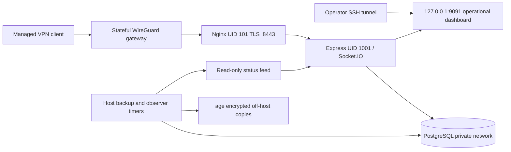

# Deployment and operational reliability

Phase 12 preserves a single Linux VPS with Docker Compose, PostgreSQL, one backend and Nginx. The WireGuard gateway remains a separately managed stateful host service. Read [the implementation plan](PHASE12_PLAN.md), [verification report](PHASE12_REPORT.md), [network operations](NETWORK_PROTECTION.md) and [governance responsibilities](ENTERPRISE_GOVERNANCE.md) before cutover.

## Supported topology and prerequisites

Use a dedicated Ubuntu 24.04 LTS VPS with at least 2 vCPUs, 4 GiB RAM and 80 GiB disk as an initial sizing assumption. Install Docker Engine, Compose **2.24.4 or newer** (`!override` support), Python 3.10+, age, OpenSSL, Git and WireGuard prerequisites. The isolated verification environment is Alpine/WSL; Ubuntu cloud-init is statically validated, not a completed cloud acceptance test. A real domain, TLS certificate, managed WireGuard enrollment, off-host backup destination and operator access are required.

Production and staging require separate VPSs or isolated network namespaces. The existing control bridge `172.20.0.0/24`, fixed edge address and default VPN address collide on a shared Docker daemon. PostgreSQL exposes no host port. Control HTTPS binds to `10.8.0.1:443` and remains VPN-gated. An optional separate SCIM listener is the only public application ingress; use verified provisioner source CIDRs and the existing [SCIM setup](ENTERPRISE_GOVERNANCE.md). IPv6 tunnel/firewall acceptance remains governed by the network runbook.



## Build and initialize

Keep the repository at `/opt/remoteshield` and deployments outside it. Pin a reviewed commit, run relevant tests, and build/publish artifacts through your own authenticated registry. No registry or cloud credentials are included. Local SHA IDs are also accepted on the same Docker daemon; registry digests are needed for replacement-host recovery.

```bash
sudo docker build --build-arg APP_REVISION="$(git rev-parse --short HEAD)" -f docker/Dockerfile.backend -t remoteshield-backend:reviewed .
sudo docker build -f docker/Dockerfile.nginx -t remoteshield-nginx:reviewed .
# Generate an age identity on a separate recovery workstation, not on the VPS:
age-keygen -o recovery-identity.txt
age-keygen -y recovery-identity.txt
# On the VPS, use only the public age1... recipient printed above:
sudo python3 operations/manage.py init /opt/remoteshield-production \
  --domain control.example.com --environment production --recipient age1REPLACE_WITH_PUBLIC_RECIPIENT
```

Initialization creates random independent credentials in a mode-0700 deployment directory. Copy the full certificate chain and private key into `certs/tls.crt` and `certs/tls.key`; set the individual files to 0444 and retain their parent directory at 0700. Compose mounts each file directly into the non-root edge. Never make the parent directory publicly traversable. Install a production-trusted certificate using a DNS challenge or your enterprise CA; public HTTP is not exposed by this topology. The lab uses an explicitly trusted fixture certificate.

Review `environment.env`, based on [production](../docker/environments/production.env.example) or [staging](../docker/environments/staging.env.example). `NODE_ENV=production` enforces VPN admission in both environments. `DB_NETWORK_TRUSTED=true` acknowledges plaintext DB traffic on the dedicated same-host Docker network; use `verify-full` plus a mounted CA for a remote database. Never rely on that acknowledgment over an untrusted network. Configure the gateway using the network runbook before binding the edge to its VPN address.

```bash
sudo python3 operations/manage.py manifest /opt/remoteshield-production \
  --name reviewed-commit --backend "$(sudo docker image inspect remoteshield-backend:reviewed --format '{{.Id}}')" \
  --edge "$(sudo docker image inspect remoteshield-nginx:reviewed --format '{{.Id}}')" --release /tmp/rsx-reviewed.json
sudo python3 operations/manage.py deploy /opt/remoteshield-production --release /tmp/rsx-reviewed.json
sudo python3 operations/manage.py observe /opt/remoteshield-production
```

`deploy` validates immutable image references and Compose configuration, starts/waits for PostgreSQL, stops application writers, streams an encrypted pre-migration backup, applies migrations and recreates/waits for the backend and edge. First deployment backs up the initial empty database before schema creation. Failures are nonzero and recorded in `events.jsonl`; logs intentionally omit command stderr to avoid leaking secrets. Inspect private container logs for diagnosis. A failing migration/startup can leave the application stopped; use the recovery procedures below. Health checks alone do not restart unhealthy containers; Docker restart policy handles exited processes, while operator alerts handle unhealthy running processes.

Onboard an organization with the existing operator CLI from the migration image, using `MIGRATION_DATABASE_URL_FILE=/run/secrets/db_owner_url` and reviewed bootstrap settings through a private temporary environment file. This uses owner credentials only in a one-shot job. See the governance runbook. Never distribute owner credentials to the backend.

### Adopting an existing Compose deployment

New deployments default to projects `remoteshield-production` and `remoteshield-staging`. Existing base deployments usually use `remoteshield`; changing project names creates a different named database volume. Do not mistake an empty new database for a migrated installation. Record the actual project/container/volume names and keep an independently tested encrypted backup before cutover.

To adopt the existing project in place, initialize a **new private configuration directory**, set `COMPOSE_PROJECT_NAME` in its `environment.env` to the verified existing project name, and replace its generated database/signing secret files privately with the actual current credentials. Both owner/runtime URLs must name the existing database and matching roles/passwords. Preserve signing keys if existing token continuity is desired. Review and reapply existing OIDC/provider mounts, SCIM configuration, gateway-status mounts and optional settings; the reference production override does not infer those installation-specific mounts. Use a reviewed Compose override in source control for nonsecret mount definitions, and review its effective configuration privately before maintenance. The helper currently supports the bundled production and optional SCIM overrides; an installation with additional mounts must extend `compose()` deliberately before adopting it.

Reload the reviewed gateway firewall during this cutover: the container edge now listens on8443 behind published443. The updated rule permits only VPN-originated DNAT traffic whose original destination is10.8.0.1:443 and translated destination is172.20.0.10 on443 or8443, preserving the legacy internal-port profile. An old gateway rule will block the new container edge. Reapply through the existing gateway setup procedure in a planned maintenance window and verify peer/outsider packet tests; do not reset gateway identities.

Stop the old application writers, verify that `manage.py ... compose ... config` resolves the intended existing database volume and secret mount paths, then deploy the reviewed release under that same project. PostgreSQL's initialization password file does not reset an already initialized database password. The pre-migration backup uses the existing database before migrations run. Keep the original configuration/artifacts and volume until the upgraded API, tenant records and clients pass acceptance. A different-project migration requires a separately rehearsed export/restore and identity reconciliation plan. Never use `down --volumes` to free the old project name.

## Configuration and secret delivery

Runtime validation accepts `DATABASE_URL_FILE`, `JWT_SECRET_FILE`, `JWT_REFRESH_SECRET_FILE`, `OIDC_STATE_KEY_FILE`, `METRICS_TOKEN_FILE` and provider-specific `CLIENT_SECRET_ENV_NAME_FILE`. Migration commands accept database URL/runtime password file variants without requiring identity keys. A nonempty direct value plus its `_FILE` variant fails; relative/missing/empty/oversized/multiline files fail without printing their content.

Compose secrets are bind-mounted files. File-source UID/GID/mode overrides are not reliably applied by Compose; this deployment uses 0444 individual files behind a 0700 host directory and limits each service's mounted names. The app cannot read the owner password/URL, and the migrator cannot read identity or metrics keys. PostgreSQL's entrypoint initially runs as root to initialize its volume, then runs the server as its packaged postgres user. Backend and edge drop all capabilities and use read-only root filesystems with bounded temporary filesystems. Docker/root operators retain full access; use encrypted VPS storage and a protected host/secret manager where required. Never mount the Docker socket into application containers.

Rotate secrets through a maintenance plan, atomically replace protected files and force-recreate affected containers; individual bind mounts retain the old inode until recreation. Database password rotation must change the actual database role as well as the URL/password files. Changing an environment file alone does not rotate existing PostgreSQL credentials. Access-key rotation invalidates JWT signatures; refresh-key rotation forces renewed authentication. Preserve/revoke OIDC transactions as needed. Export an encrypted configuration backup after each reviewed change. Do not replace gateway keys as a side effect of app deployment.

## Health, logs, metrics and alerts

`GET /health` reports process liveness. `GET /ready` checks the runtime role and migration checksums against the connected DB, returning 503 on DB/schema failure or drain. New ordinary requests receive 503 during drain. SIGTERM stops detection work, disconnects sockets, closes HTTP/DB/operations listeners and applies a bounded shutdown watchdog. A forced shutdown is logged and exits nonzero. Clients must reconnect and reauthenticate according to their existing lifecycle.

JSON logs include request IDs and server-generated trace/span IDs; sampled HTTP/database spans contain template routes, status, elapsed time and outcome, without SQL/parameters or credentials. `TRACE_SAMPLE_RATE` is 0–1 (default 0.1). Traces cover this one process; no collector/exporter or cross-service parent propagation is claimed. Docker uses the `local` log driver with five 10 MiB files per service. Forward logs off-host using an approved host agent, with access controls and retention suited to your privacy policy. Database events and existing tenant audit logs remain separate from infrastructure operation logs.

`METRICS_ENABLED` starts a separate internal HTTP listener on 9090. The production override publishes only `127.0.0.1:9091` (staging 9092). `/metrics` and `/status` require the independent metrics bearer token; `/dashboard` serves only an empty UI shell. The dashboard retains the token in tab memory and clears it on disconnect. It displays measured process/database/request data and backup/observer state, never demo statistics. Do not publish this port or proxy it through the public edge.

```bash
ssh -L 9091:127.0.0.1:9091 rsxops@YOUR_VPS
# Browse http://127.0.0.1:9091/dashboard locally and enter the metrics token privately.
sudo cp operations/systemd/remoteshield-* /etc/systemd/system/
sudo systemctl daemon-reload
sudo systemctl enable --now remoteshield-backup.timer remoteshield-observer.timer
sudo systemctl list-timers 'remoteshield-*'
```

Review the unit paths before installing. Backups run daily around 02:00 UTC with persistent catch-up and jitter; the observer runs every minute. Maintenance commands serialize on a deployment lock. A long backup can delay observation; feeds older than three minutes are explicitly stale. The observer records service health, backup freshness (default 25 hours), TLS expiry within seven days and disk usage over 85%. Alert transitions are deduplicated in protected host state and the operational dashboard. Timer failures go to systemd journal. This is local alerting; configure your own on-call delivery. [Optional Prometheus configuration](../operations/prometheus.yml.example) and [rules](../operations/prometheus-alerts.yml) cover availability, schema/DB readiness, errors, stale backup and observer failure. Run a collector only on a private network with its mounted token file. It is not installed automatically.

## Resource limits and scaling

PostgreSQL: 1536 MiB, 1.5 CPUs, 256 PIDs. Backend: 768 MiB, one CPU, 128 PIDs, 384 MiB Node old-space, default DB pool 20 (staging 10). Edge: 128 MiB, 0.25 CPU, 64 PIDs, two workers. Migrator: 512 MiB and one CPU while the application is stopped. Optional SCIM edge adds 128 MiB. These ceilings can exceed a two-core VPS's available CPU in aggregate; contention is expected under load. Reserve memory for Linux, Docker, WireGuard, Unbound, backups and filesystem cache. Monitor RSS, event-loop delay, pool waiting, DB/volume growth, disk and gateway packet/CPU counters before raising limits.

Keep one backend replica. Socket.IO rooms, client subscriptions and rate-limit counters are process-local; restarts reset counters and disconnect sockets. Nginx re-resolves changed backend addresses through Docker DNS. Horizontal scaling requires measured need plus shared abuse limits, verified Socket.IO coordination and connection routing; none is claimed here. Scale WireGuard gateways independently with unique address/identity allocations, peer placement, revocation propagation, fail-closed routing/DNS and tested recovery. Duplicating one gateway's keys or replaying an old registry can reactivate revoked peers.

See the verification report for the bounded local load measurement. It is a smoke test on shared WSL hardware, not a sustained-user, tunnel-throughput or cloud SLA guarantee. Establish application-specific latency/error targets and RTO/RPO before production approval.

## Rollback and disaster recovery

Use [DISASTER_RECOVERY.md](DISASTER_RECOVERY.md). Never use `compose down --volumes` on a production deployment. Keep the prior registry artifacts, encrypted DB/configuration backups, a separate recovery key and stateful gateway recovery material. Local backups on the same VPS do not survive VPS loss. Daily logical dumps provide an approximately 24-hour scheduling RPO only if successful copies reach an independent location; there is no PITR/WAL archive in this phase.

## DigitalOcean target and cost assumptions

[Terraform](../infrastructure/digitalocean/) defines one Ubuntu VPS, registered SSH keys, a restricted SSH cloud firewall, WireGuard ingress and optional source-restricted SCIM ingress. `cloud-init` installs prerequisites and an operator account. It does not deploy the app, configure WireGuard, issue certificates, deliver secrets or validate an actual provider tenancy. `prevent_destroy` guards accidental VPS replacement; intentionally replacing it requires a separately reviewed data recovery plan. Protect Terraform state, which includes operator public-key metadata and addresses. Supply `DIGITALOCEAN_TOKEN` privately; no credentials are embedded in examples.

```bash
cd infrastructure/digitalocean
terraform init -backend=false -lockfile=readonly
terraform fmt -check -recursive
terraform validate
terraform test                 # Mocked provider plans; no cloud API calls
# Only an explicitly authorized operator may provide real credentials and apply a reviewed plan.
```

As checked on 2026-11-16, DigitalOcean lists the basic 2 vCPU/4 GiB/80 GiB/4 TB plan at approximately **US$24/month**. Weekly provider backups add 20% (about $4.80), giving roughly **$28.80/month** before taxes, offsite backup storage, bandwidth overage, domain, alert/log services or operator labor. Provider backups are disabled by default in Terraform and do not replace application restore verification. Actual prices and region availability must be confirmed at purchase. [Official Droplet pricing](https://www.digitalocean.com/pricing/droplets), [firewall pricing](https://docs.digitalocean.com/products/networking/firewalls/details/pricing/). No resources or paid services were provisioned for verification.
