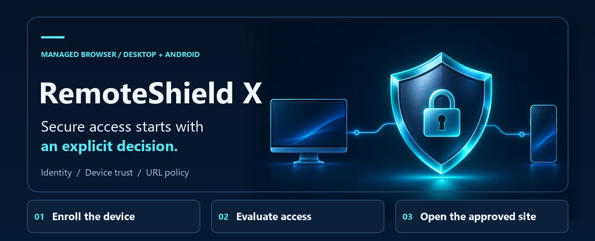
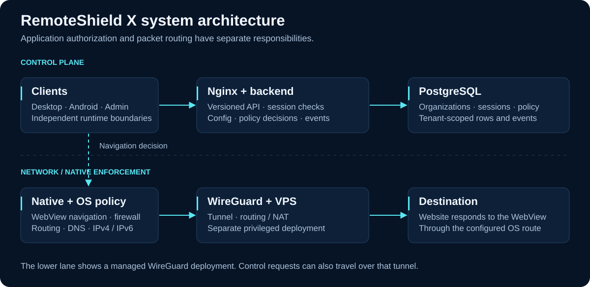
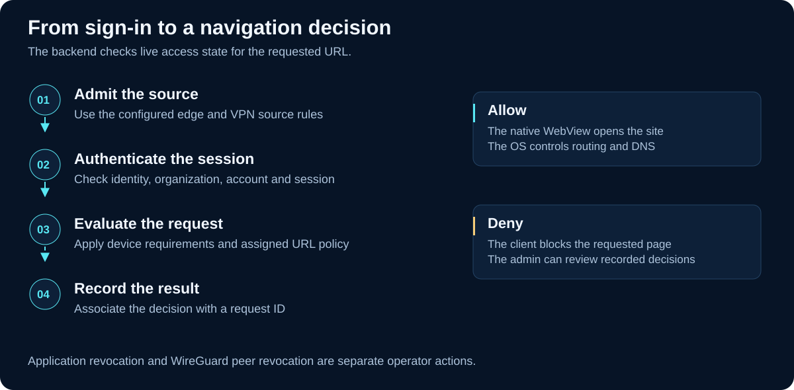
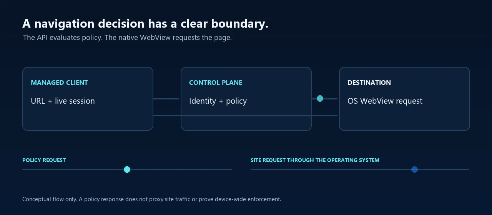
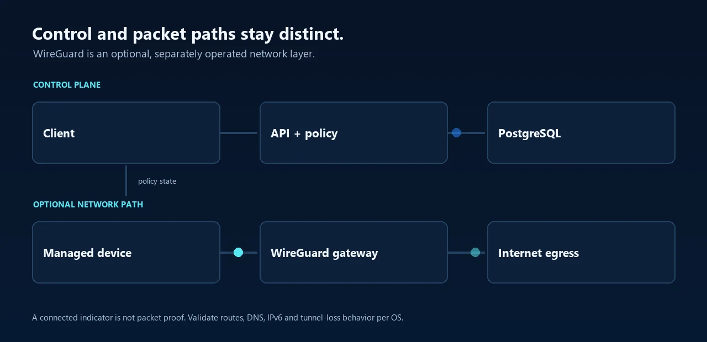

# RemoteShield X | static edition

**Managed browsing with explicit access decisions for remote teams.**

RemoteShield X is an in-development platform with desktop and Android clients, a tenant-scoped control plane and optional separately operated WireGuard enforcement. The control plane evaluates access decisions. Device-wide packet protection depends on operating-system routing, gateway policy and packet-level acceptance.

## Project status

The verified snapshot uses source `8d0f7da` and preview `v2.5.0-preview.4`. Backend, desktop, Flutter, network-namespace and isolated Compose evidence is recorded in the phase reports. The required hosted quality gate failed because dependency/secrets and backend static-analysis jobs failed. The preview is experimental and is not a production security certification.

| Area | Recorded evidence | Open acceptance |
| --- | --- | --- |
| Backend | Versioned API, tenant-aware PostgreSQL, session lifecycle and audit paths. Hosted run: 156 unit and 48 database tests passed. | Resolve 52 backend static-analysis observations. |
| Desktop | Tauri 2 with Rust, React and TypeScript. Windows, Linux and Intel macOS checks passed. | Signing, installation and upgrade acceptance, and per-OS traffic checks. |
| Android | Flutter analysis and tests, API 36 emulator boundary evidence, preview APK checks. | Managed physical-device, signing and network acceptance. |
| Network | WireGuard namespace scenarios and Compose configuration evidence. | Packet-level DNS, IPv6, loss and recovery proof for each target profile. |
| Operations | 35 isolated Compose deployment and recovery assertions. | Off-host production recovery, alert ownership and capacity profile. |

See the [complete README](../README.md) for architecture, platform setup and screenshots. The [API reference](API_REFERENCE.md), [architecture](ARCHITECTURE.md), [security model](SECURITY_MODEL.md) and [threat model](THREAT_MODEL.md) describe implementation boundaries.

## Published application downloads

The newest published stable release listed by GitHub is [v2.4.0](https://github.com/manikantbindass/RdPBrowser/releases/tag/v2.4.0), published 2026-04-18. The release tag is unsigned, and its desktop filenames say 2.2.4. The [historical package inventory](../README.md#published-application-downloads) records hashes for the published files. No iOS release is published. Current verification builds use the [v2.5.0-preview.5 Actions run](https://github.com/manikantbindass/RdPBrowser/actions/runs/44673849388).

**Avoid the v2.4.0 Android downloads.** The published ARM64 APK reports the example package `com.example.android` and a generic Flutter launcher. A corrected signed APK is pending.

## Static visual diagrams

The complete README includes additional original looping diagrams with static WebP alternatives. These assets are conceptual and do not claim to demonstrate traffic enforcement.

## Setup and verification

Follow [getting started](GETTING_STARTED.md) for local Docker Compose, desktop and Android workflows. Use [testing](TESTING.md) to reproduce scoped evidence and separate passed checks from remaining acceptance. Review [deployment](DEPLOYMENT.md), [release process](RELEASE_PROCESS.md) and [roadmap](ROADMAP.md) before a deployment decision.

## Limitations

No universal all-traffic, DNS-leak, screenshot-prevention, binary-tamper or Android compatibility guarantee is made. Client signals are not hardware attestation. Evidence exports do not establish SOC 2 certification. The source record has known blocking security findings. Review [SECURITY.md](../SECURITY.md) before reporting a vulnerability.
